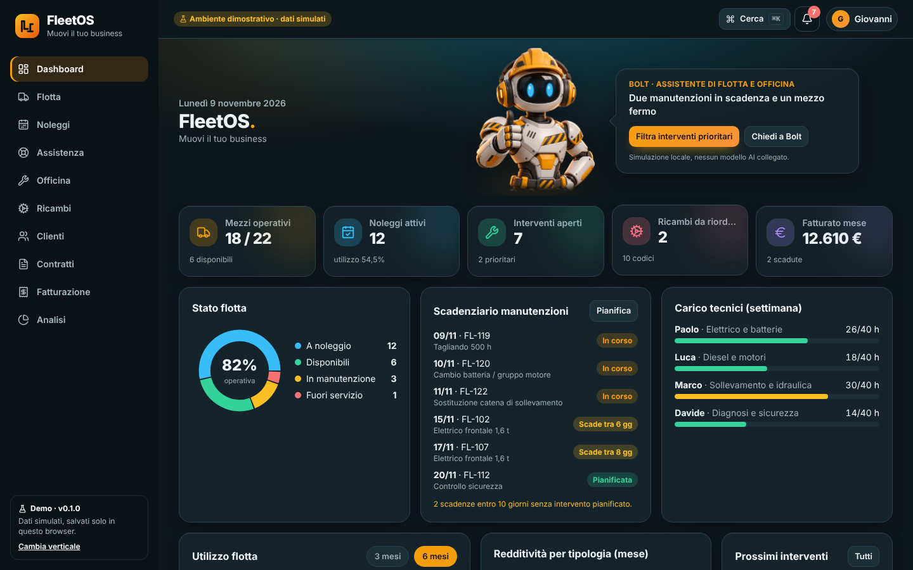

# FleetOS

Gestionale per noleggio, vendita e assistenza muletti. Demo web con assistente **Bolt** — tema dark antracite/blu petrolio con accenti ambra.

> **Ambiente dimostrativo · dati simulati.** Nessun backend e nessun modello AI collegato: i dati vivono nel `localStorage` del browser e l'assistente è una simulazione locale basata su regole.



## Sviluppo
```bash
npm install
npm run dev      # http://localhost:5173  (reindirizza a /fleet)
npm run build    # tsc + vite build → dist/
npm run preview
```

## Deploy su Coolify
1. **New Resource → Public/Private Repository** (GitHub app o deploy key) → scegli questo repository, branch `main`.
2. **Build Pack: `Dockerfile`** (il `Dockerfile` è nella root).
3. **Ports Exposes: `80`**. Nessuna variabile d'ambiente richiesta.
4. Imposta il dominio (es. `fleet.demo.tuodominio.it`) e avvia il deploy; il certificato è gestito da Coolify.
5. Healthcheck: `GET /healthz` → `ok` (già definito nel Dockerfile).

L'immagine è `node:22-alpine` (build) → `nginx:1.27-alpine` (serve statico con fallback SPA). Gli asset hashati sono in cache per un anno, `index.html` mai.

## Struttura
```
src/shared/        AppShell, MetricCard, Charts, DataTable, Drawer/Modal, CommandPalette, Notifications, Companion, CompanionPanel
src/ai/provider.ts Interfaccia AIProvider + MockProvider (simulazione) — punto di innesto per un LLM
src/lib/utils.ts   Helper; TODAY è fissa (9/11/2026) per avere numeri riproducibili
src/products/fleet/ fixtures tipizzate, store (zustand + persist), config, regole del companion, pagine
public/companions/ bolt.png (illustrazione originale, generata con Higgsfield)
```

## Note
- Il companion ha tracking del mouse e reazioni; rispetta `prefers-reduced-motion`.
- I dati demo si azzerano svuotando il localStorage del browser.
- Parte della suite **AM Services · Vertical Suite** (BeautyOS · CollectOS · FleetOS).
